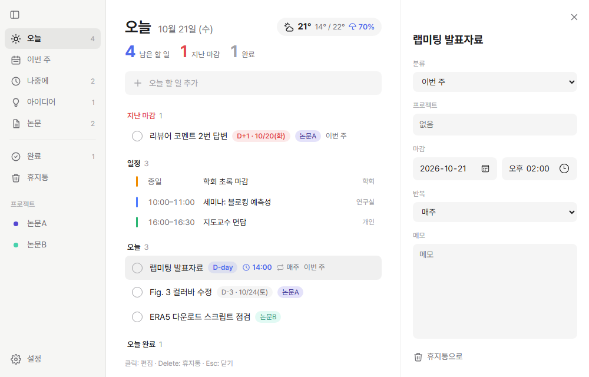
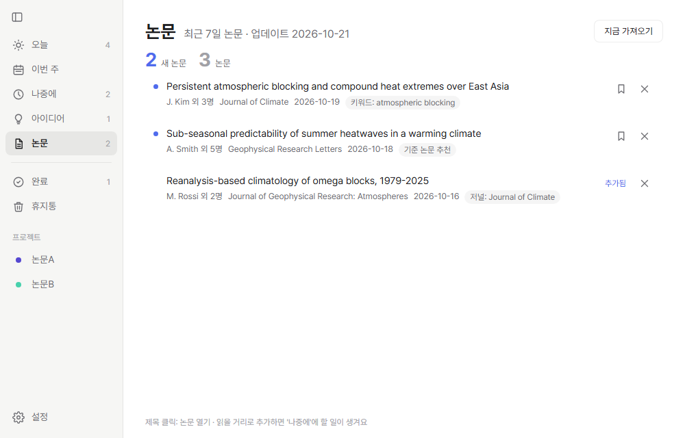
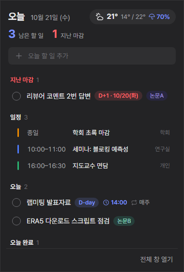

# Labmate

연구자를 위한 가벼운 Windows 투두리스트입니다. 할 일 관리를 중심으로 구글 캘린더 연동, 기상청 동네예보, 매일 아침 받아 보는 새 논문 알림을 함께 담았습니다.

모든 데이터는 내 컴퓨터에만 저장됩니다. 자세한 내용은 [개인정보처리방침](docs/privacy.md)을 참고하세요.

설치 방법은 [아래 설치 안내](#설치)를 확인하세요.

## 주요 기능

**할 일**
- GTD 분류 4가지: 오늘 / 이번 주 / 나중에 / 아이디어
- 마감일과 D-day 표시, 시간 지정, 반복(매일·매주·매월), 프로젝트 태그, 메모
- 마감이 지난 할 일과 오늘 마감인 할 일은 분류와 관계없이 "오늘"에 표시
- 휴지통(30일 후 자동 삭제)



**구글 캘린더**
- 오늘 화면에는 오늘 일정, 이번 주 화면에는 오늘부터 7일간의 일정 표시
- 날짜와 시간이 있는 할 일은 기본 캘린더에 일정으로 자동 등록
- 캘린더에서 일정을 수정하면 할 일에 반영되고, 삭제하면 할 일이 휴지통으로 이동

**날씨 (기상청 동네예보)**
- 현재 기온, 오늘 최저·최고 기온, 시간별 예보, 강수 확률
- 위치는 동네 이름으로 검색해서 지정

**논문 알림**
- 기준 논문(DOI)과 비슷한 최근 논문 추천 (Semantic Scholar)
- 키워드·저널 기준 최근 7일 논문 (OpenAlex)
- 하루 한 번 자동으로 가져오고, 새 논문이 오면 Windows 알림 (문구 수정 가능)
- 프리프린트 포함 여부 선택, "읽을 거리로 추가"를 누르면 "나중에"에 할 일 생성



**편의 기능**
- 트레이 상주: 아이콘에 오늘 남은 할 일 수 표시, 클릭하면 작업표시줄 위에 오늘 패널 표시
- 어디서든 `Ctrl + Alt + T`를 누르면 바로 할 일 입력
- 일정 시작 전 알림 (끄기 / 5 / 10 / 15 / 30분 전)
- Windows 시작 시 자동 실행, 라이트·다크 테마, 한국어·English, 글꼴 선택



## 설치

1. [Releases](../../releases) 페이지에서 `Labmate-Setup-<버전>.exe`를 내려받아 실행합니다.
   - 관리자 권한 없이 사용자 폴더에 설치됩니다.
   - 코드 서명이 없는 프로그램이라 처음 실행할 때 "Windows의 PC 보호" 창이 뜰 수 있습니다. **추가 정보 → 실행**을 누르세요.
2. 설치가 끝나면 작업표시줄 오른쪽 트레이에 아이콘이 생깁니다. 처음에는 `^` 안에 숨겨져 있을 수 있으니, 아이콘을 작업표시줄로 끌어다 놓으면 항상 보입니다.

**요구 사항**: Windows 10 또는 11 (64비트), Microsoft Edge WebView2 런타임(Windows 11에는 기본 포함, Windows 10도 대부분 설치되어 있음)

## 초기 설정

모든 설정은 왼쪽 아래 **⚙ 설정**에 있습니다. 화면 이미지와 함께 보려면 [설정 가이드](docs/guide.md)를 참고하세요.

### 구글 캘린더
1. 설정 → 구글 캘린더 → **연결**을 누르면 브라우저가 열립니다.
2. 구글 계정으로 로그인하고 권한을 허용합니다.
   - "Google에서 확인하지 않은 앱" 화면이 나오면 **고급 → Labmate(으)로 이동**을 누르세요.

### 날씨
1. [기상청 API 허브](https://apihub.kma.go.kr)에 가입하고 인증키를 발급받습니다.
2. API 허브에서 "단기예보 조회서비스"의 **초단기실황조회**와 **단기예보조회**를 활용신청합니다.
3. 설정 → 날씨에 인증키를 저장하고, 위치 칸에서 동네 이름을 검색해 고릅니다.

### 논문 알림
1. 설정 → 논문 알림에서 아래 중 하나 이상을 추가합니다.
   - **기준 논문**: 내 논문이나 자주 보는 논문의 DOI (예: `10.1175/JCLI-D-17-0034.1`)
   - **키워드**: 제목·초록에서 찾을 구절 (예: `atmospheric blocking`). 넓은 단어보다 구체적인 구절이 정확합니다.
   - **저널**: 이름으로 검색해서 고르면 키워드 결과를 그 저널로 좁힙니다.
2. 설정을 마치면 1분 안에 첫 논문을 가져오고, 그 뒤로는 하루 한 번씩 가져옵니다. 언제든 논문 탭의 **지금 가져오기**로 바로 받아 볼 수도 있습니다.

## 데이터

- 저장 위치: `%APPDATA%\Labmate\` (할 일과 설정은 `todo.db` 파일 하나에 들어 있습니다)
- 백업: 이 폴더를 복사해 두면 됩니다.
- 앱을 삭제해도 데이터는 남습니다. 완전히 지우려면 이 폴더를 삭제하세요.

## 개발

Python 3.12 기준입니다.

```bash
conda create -n todo -c conda-forge python=3.12
conda activate todo
pip install -r requirements.txt
python -m labmate          # 실행
python -m pytest            # 테스트
python build.py             # dist/ 에 exe와 설치 파일 생성 (설치 파일은 Inno Setup 6 필요)
```

- 구조: `labmate/db.py`(저장소), `api.py`(화면과 Python 사이의 연결), `desktop.py`(창·트레이·알림), `gcal.py`(구글 캘린더), `weather.py`·`places.py`(날씨·동네 검색), `papers.py`(논문 알림), `web/`(화면 HTML·CSS·JS)
- 기상청 동네 목록 갱신: 공공데이터포털 "기상청_단기예보 조회서비스" 활용가이드의 `격자_위경도` 엑셀 파일로 `python packaging/make_places.py <엑셀 파일>`을 실행합니다.
- 구글 캘린더를 쓰려면 Google Cloud에서 "데스크톱 앱" OAuth 클라이언트를 만들고, 앱 설정에서 JSON 파일을 가져오세요. 그 파일이 `%APPDATA%\Labmate\client_secret.json`에 있으면 `build.py`가 설치 파일에 함께 넣습니다(저장소에는 올라가지 않습니다).

## 출처와 라이선스 고지

- 기상 예보: [기상청 API 허브](https://apihub.kma.go.kr) 단기예보 조회서비스
- 동네·격자 목록: 기상청 단기예보 조회서비스 오픈API 활용가이드의 격자_위경도 자료 (공공데이터포털)
- 논문 정보: [Semantic Scholar API](https://www.semanticscholar.org/product/api), [OpenAlex](https://openalex.org) (CC0)
- 글꼴: [Pretendard](https://github.com/orioncactus/pretendard) © Kil Hyung-jin, SIL Open Font License 1.1 (`labmate/web/fonts/Pretendard-OFL.txt`)
- 사용한 라이브러리: pywebview, pystray, Pillow, google-api-python-client, google-auth-oauthlib

---

## English

Labmate is a lightweight Windows to-do app for researchers: tasks with buckets, due dates and recurrence, Google Calendar sync, Korea Meteorological Administration neighbourhood forecasts, and daily new-paper alerts from Semantic Scholar and OpenAlex. It lives in the system tray, opens a Today panel above the taskbar, and adds a task from anywhere with `Ctrl + Alt + T`. All data stays on your computer; see the [privacy policy](docs/privacy.md). Download the installer from [Releases](../../releases). The interface is available in Korean and English.
