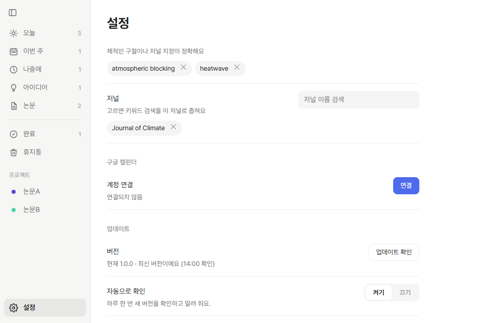
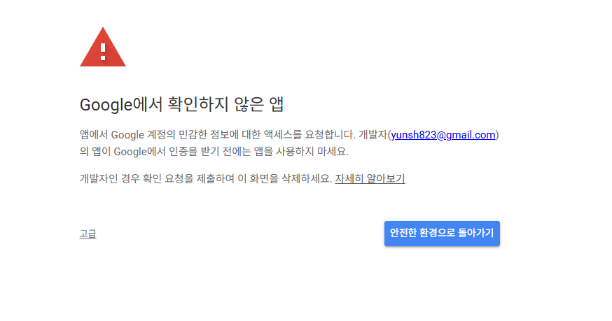
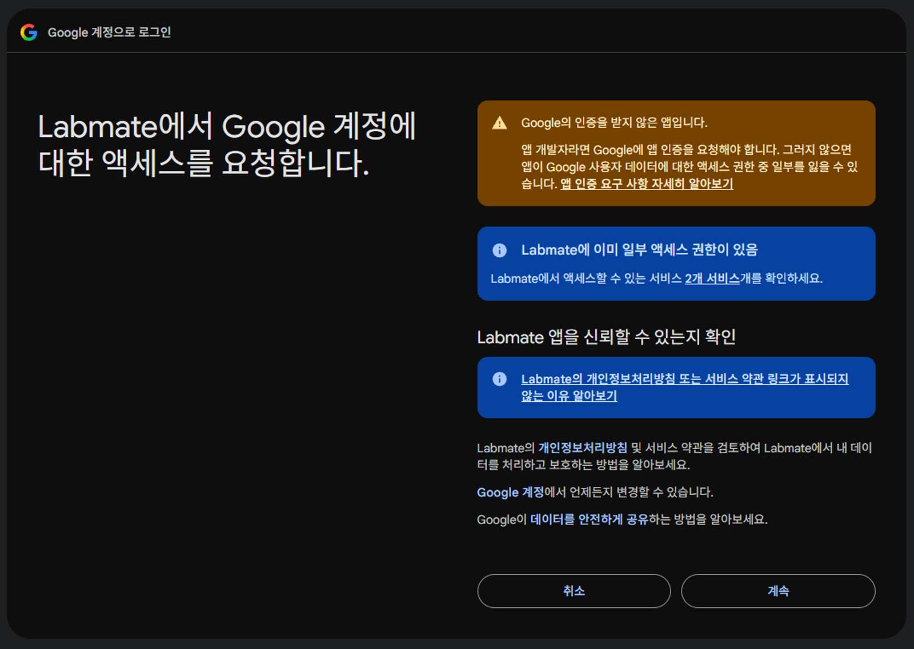
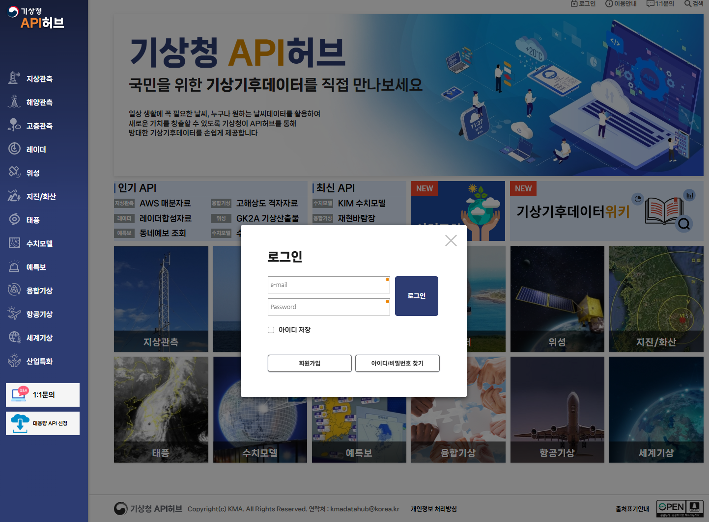
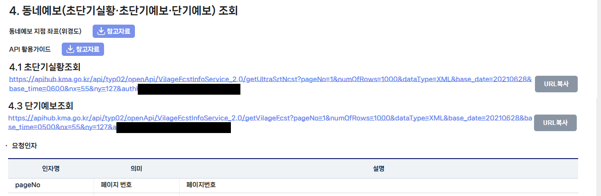
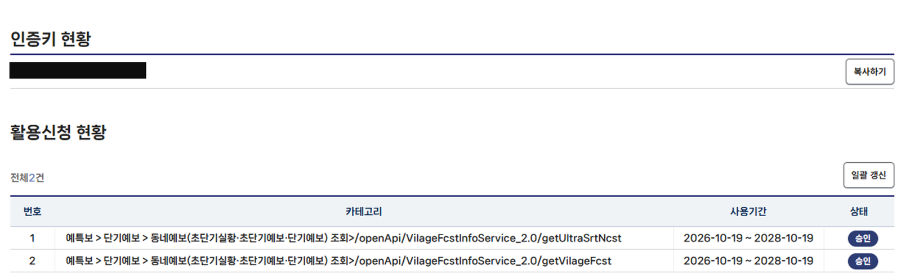
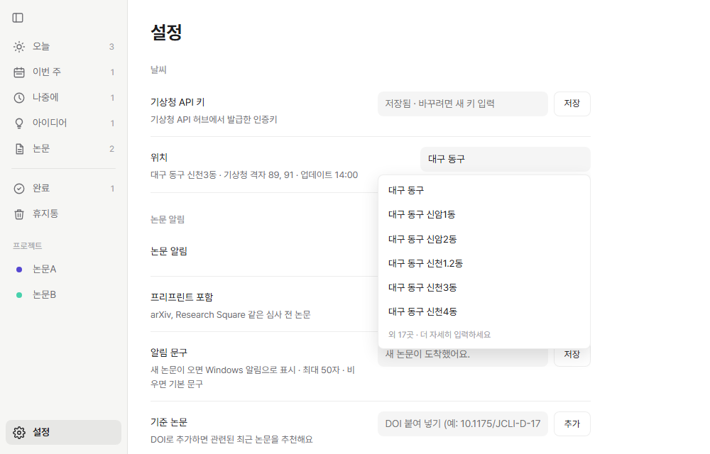
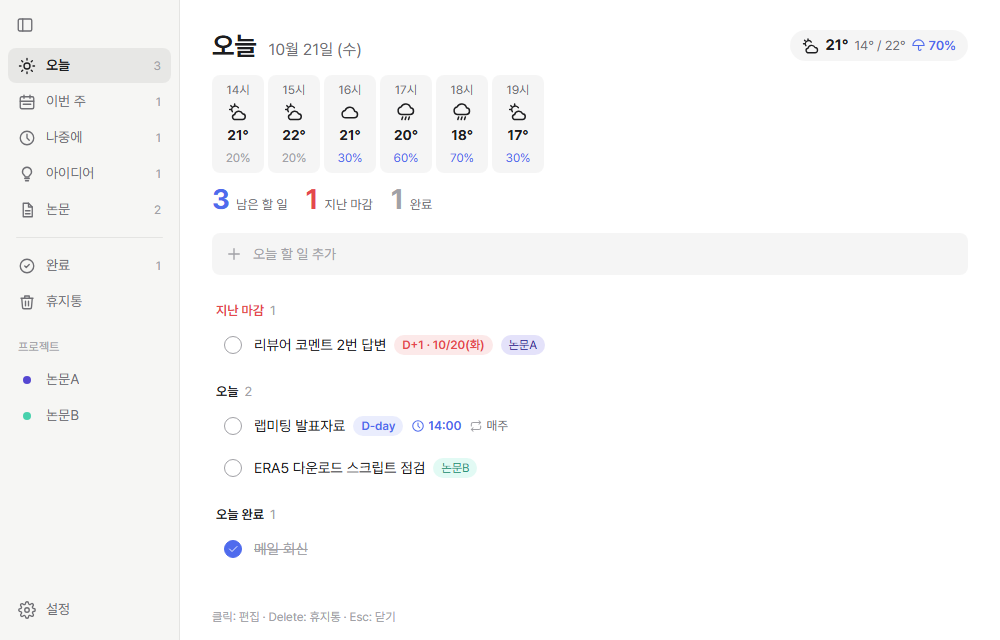
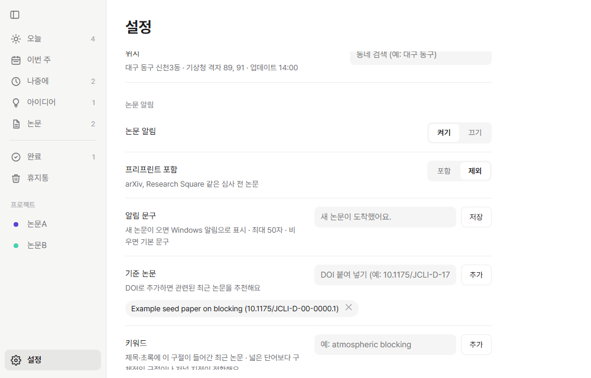

# Labmate 설정 가이드

설치를 마친 뒤 처음 한 번만 하면 되는 설정입니다. 모든 설정은 앱 왼쪽 아래 **⚙ 설정**에 있습니다.

- [1. 구글 캘린더 연결](#1-구글-캘린더-연결)
- [2. 날씨: 기상청 API 키 발급과 동네 지정](#2-날씨-기상청-api-키-발급과-동네-지정)
- [3. 논문 알림](#3-논문-알림)

---

## 1. 구글 캘린더 연결

연결하면 오늘 화면에 내 캘린더 일정이 보이고, 시간이 정해진 할 일이 캘린더에 자동으로 올라갑니다. 구글 클라우드 설정 같은 준비는 필요 없습니다.

**① 설정 → 구글 캘린더 → 연결**을 누릅니다. 브라우저가 열립니다.

**② "Google에서 확인하지 않은 앱" 화면이 나오면 고급 → Labmate(으)로 이동**을 누릅니다.
개인이 만든 앱이라 구글의 별도 검증을 받지 않아서 나오는 안내입니다.

**③ 캘린더 권한을 허용**합니다. 앱이 일정을 읽고, 할 일을 일정으로 만들 수 있도록 하는 권한입니다.

**④ 브라우저에 "connected" 안내가 뜨면 탭을 닫습니다.** 앱 설정에 "연결됨"과 마지막 동기화 시각이 표시되면 완료입니다.

> 연결을 끊으려면 설정에서 **연결 해제**를 누르세요. 구글 계정 쪽 권한까지 지우려면 [Google 계정의 서드 파티 연결](https://myaccount.google.com/connections)에서 Labmate를 삭제하면 됩니다.

---

## 2. 날씨: 기상청 API 키 발급과 동네 지정

기상청 동네예보를 쓰려면 본인의 기상청 API 허브 인증키가 필요합니다. 발급은 무료입니다.

**① [기상청 API 허브](https://apihub.kma.go.kr)에 회원가입하고 로그인**합니다.

**② "단기예보 조회서비스"에서 두 항목을 활용신청**합니다.
- **초단기실황조회**: 현재 기온과 강수
- **단기예보조회**: 시간별 예보, 최저·최고 기온, 강수확률
- 초단기예보조회는 신청하지 않아도 됩니다.

**③ 발급된 인증키를 복사**합니다.

**④ 앱의 설정 → 날씨에서 인증키를 붙여 넣고 저장**한 뒤, **위치 칸에 동네 이름을 입력해 고릅니다.**
- 큰 지역부터 입력하면 점점 좁혀집니다. 예: `대구` → `대구 동구` → `대구 동구 신천3동`
- 동네 이름 일부만 입력해도 됩니다. 예: `신천`

**⑤ 오늘 화면 제목 옆에 날씨가 표시**됩니다. 누르면 시간별 예보가 펼쳐지고, 비 올 확률이 60% 이상이면 우산 표시가 붙습니다.

> 활용신청 직후에는 "활용신청이 필요한 API 입니다"라는 오류가 잠시 보일 수 있습니다. 승인이 끝나면 30분 안에 날씨가 표시되고, 설정 → 날씨에서 **저장**을 누르면 바로 다시 가져옵니다.

---

## 3. 논문 알림

설정한 기준 논문·키워드·저널을 바탕으로 하루 한 번 최근 논문을 가져와 알려 줍니다.

**① 설정 → 논문 알림에서 아래 중 하나 이상을 추가**합니다.
- **기준 논문**: 내 논문이나 자주 보는 논문의 DOI를 붙여 넣으면, 비슷한 최근 논문을 추천합니다. (예: `10.1175/JCLI-D-17-0034.1` 또는 `https://doi.org/...` 그대로)
- **키워드**: 제목·초록에서 찾을 구절입니다. `heatwave`처럼 넓은 단어보다 `atmospheric blocking`처럼 구체적인 구절이 정확합니다.
- **저널**: 이름으로 검색해서 고르면, 키워드 결과를 그 저널로 좁힙니다.
- **프리프린트 포함**: arXiv 같은 심사 전 논문도 받을지 고릅니다. 기본은 제외입니다.
- **알림 문구**: 새 논문이 왔을 때 Windows 알림에 표시할 문구입니다. 최대 50자이고, 비우면 "새 논문이 도착했어요."로 표시됩니다.

**② 사이드바의 논문 탭**에서 받은 논문을 봅니다.
- 제목을 누르면 브라우저에서 논문이 열립니다.
- 🔖 버튼(읽을 거리로 추가)을 누르면 "나중에"에 "읽기: 논문 제목" 할 일이 생깁니다.
- ✕ 버튼을 누르면 목록에서 숨깁니다.
- **지금 가져오기**로 언제든 바로 새 논문을 받아 볼 수 있습니다.

